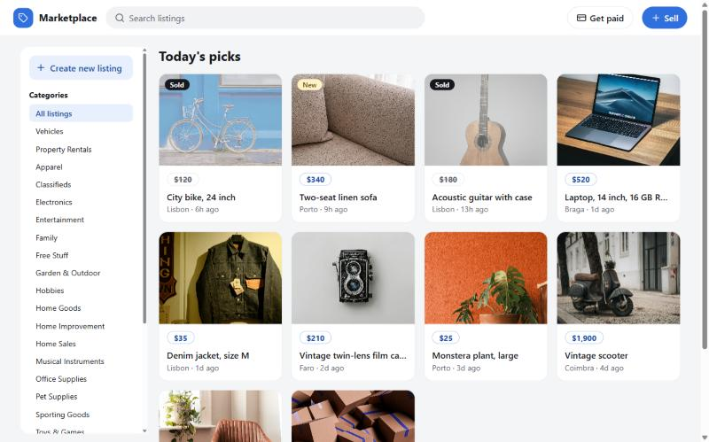
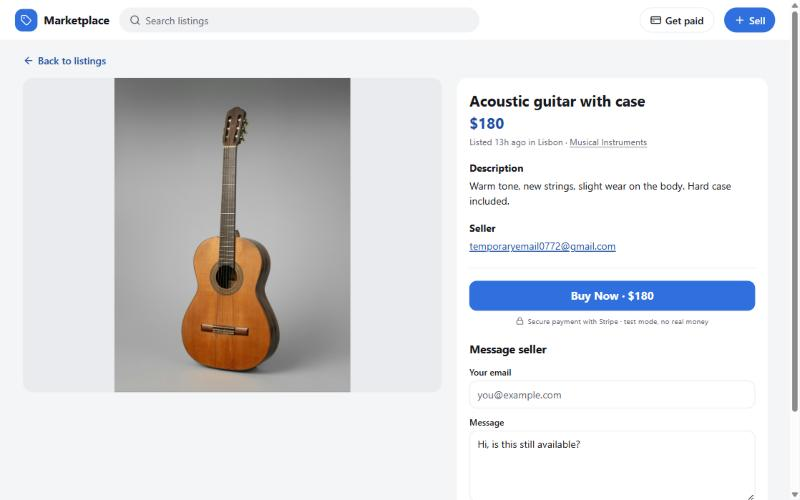
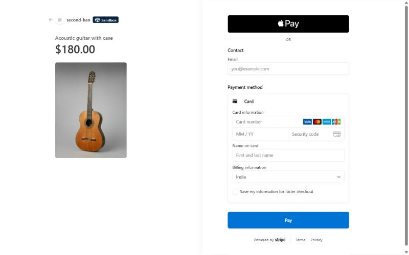
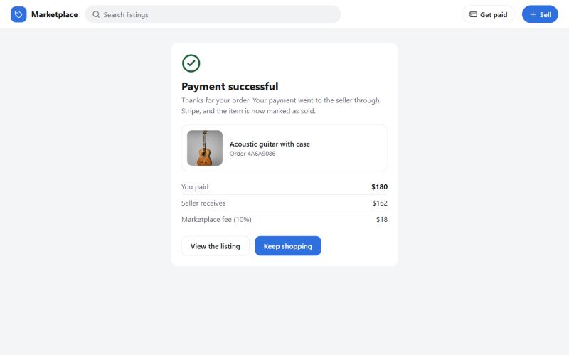

# Marketplace with Stripe Connect

The Marketplace from Test 3, now able to take payments. Sellers connect a Stripe account, their listings get a **Buy Now** button, buyers pay with Stripe Checkout, the seller is paid minus a 10% platform fee, and the item is marked **Sold**. Built with React, Next.js, Supabase and Stripe Connect, and it runs entirely in Stripe's sandbox (test mode), so no real money moves.

**See it live:** https://marketplace-stripe-connect.vercel.app



## Try it

1. Open any listing whose seller is connected (it shows **Buy Now**), for example the acoustic guitar.
2. Click **Buy Now** and pay with the test card `4242 4242 4242 4242`, any future expiry date, any CVC and any name.
3. You land on the success page; the listing now shows **Sold** and the order is saved in Supabase.

To connect a new seller, click **Get paid** in the header (on phones: **Sell**, then *Want buyers to pay online?*), enter the email used on your listings and finish Stripe's onboarding with [Stripe's test data](https://docs.stripe.com/connect/testing): **Use test phone number**, code `000000`, date of birth `01/01/1901`, address line `address_full_match`, IBAN `EE382200221020145685`, and **Use test data** wherever Stripe offers it.

## Payments with Stripe Connect

### 1. Seller onboarding
- **Get paid with Stripe** (`/connect`): the seller enters the email on their listings and clicks **Connect with Stripe**.
- The server creates a connected account and sends the seller to **Stripe-hosted onboarding**. The connected account ID is saved in Supabase (`sellers` table) against that email.
- When the seller comes back, the app checks the account with Stripe and shows **You're connected**, or a button to continue if Stripe still needs details. Expired onboarding links are renewed automatically.
- No login is needed: every listing with that email gets the Buy Now button.

### 2. Buy Now
- Listings from connected sellers show **Buy Now**; listings from sellers who haven't finished onboarding can't be bought (the page says so, and the server refuses too).
- Buy Now opens **Stripe Checkout** for that item's price, with its photo and title.
- Free items and anything under $0.50 (Stripe's minimum) keep only Message seller.

### 3. Paying the seller
- The payment is a **direct charge** on the seller's connected account with an **application fee of 10%** for the marketplace.
- The marketplace pays Stripe's processing fee, so the seller receives exactly the price minus 10%: for a $120 item, the seller gets $108 and the marketplace $12.

### 4. Order confirmation
- After paying, the buyer sees a **success page** with the item, the amount paid and the split between seller and marketplace.
- A **Stripe webhook** (`/api/stripe/webhook`, signature checked on every request) confirms the payment, saves the order in Supabase as **paid** and marks the listing **Sold**. Sold items stay visible with a Sold badge and can't be bought again.
- As Stripe recommends for Checkout, the success page runs the same confirmation, checking the payment with Stripe directly. Whichever runs first records the order; the other then changes nothing, so an order is never recorded twice.
- The webhook also keeps each seller's "can take payments" state up to date (`account.updated`), and ignores events from other apps that share the sandbox.
- If two buyers pay for the same item at the same moment, only one order can be marked paid; the other payment is refunded automatically.
- The seller also gets a "Your item sold" email with the amount and fee (through Brevo).

## Everything from Test 3

- **Create a listing** with a photo, title, description, price, category, email and optional location, saved in Supabase, with a live preview.
- **Browse all listings** with category tabs, price range and sort.
- **A page for every listing** with the full photo and details, and **Message the seller**.
- **Keyword search** in titles and descriptions, and a **real email to the seller** for every message, with Reply-To set to the buyer.
- Works by keyboard, labelled for screen readers, and laid out for phones.

## Screenshots

All screenshots are in the [`screenshots`](screenshots) folder.

| File | What it shows |
|---|---|
| [`01-home.jpg`](screenshots/01-home.jpg) | Home page with listings; a bought item shows Sold |
| [`02-connect.jpg`](screenshots/02-connect.jpg) | Get paid with Stripe: the seller enters their email |
| [`03-stripe-onboarding.jpg`](screenshots/03-stripe-onboarding.jpg) | Stripe-hosted seller onboarding |
| [`04-connected.jpg`](screenshots/04-connected.jpg) | Back from Stripe: the seller is connected |
| [`05-buy-now.jpg`](screenshots/05-buy-now.jpg) | A listing from a connected seller with Buy Now |
| [`06-checkout.jpg`](screenshots/06-checkout.jpg) | Stripe Checkout for that item |
| [`07-success.jpg`](screenshots/07-success.jpg) | The success page with the payment split |
| [`08-sold.jpg`](screenshots/08-sold.jpg) | The listing after purchase, marked Sold |
| [`09-order-in-supabase.png`](screenshots/09-order-in-supabase.png) | The paid order saved in Supabase |
| [`10-phone.jpg`](screenshots/10-phone.jpg) | A listing with Buy Now on a phone |

| Buy Now | Stripe Checkout | Success page |
|---|---|---|
|  |  |  |

## Stack

Next.js (App Router), React 19, TypeScript and Tailwind CSS, with Supabase for the database and photo storage, Stripe Connect for payments (the official `stripe` Node SDK), Brevo for email, deployed on Vercel. Buttons, inputs and cards are hand-written; there is no component library.

Built with [Claude Code](https://claude.com/claude-code) as a pair programmer.

## How the data and keys are protected

- The Stripe secret key, the webhook signing secret, the Supabase secret key and the Brevo key are used only on the server and are kept in environment variables, never in the repository.
- Pages use Supabase's public key. What a visitor can do is decided by rules in the database:

| A visitor can | A visitor cannot |
|---|---|
| Read listings, including whether they are sold | Mark a listing sold, or edit or delete it |
| See which seller emails can take payments | See any Stripe account ID, or add or change a seller |
| Create listings and send messages, within limits | Read or write orders, or read messages and buyers' emails |

- Orders, sellers and Sold marks are written only by the server, after checking with Stripe. Starting onboarding is limited to 5 times per email and 50 times in total an hour.
- The rules are in [`supabase/setup.sql`](supabase/setup.sql) and [`supabase/stripe-connect.sql`](supabase/stripe-connect.sql).

## Set it up yourself

1. Create a project at [supabase.com](https://supabase.com). In the SQL Editor, run [`supabase/setup.sql`](supabase/setup.sql) once, then [`supabase/stripe-connect.sql`](supabase/stripe-connect.sql) once. The first creates the listings, messages, photo storage and ten starter listings (their photos are uploaded separately under the file names in the script); the second adds sellers, orders and the Sold mark.
2. Copy `.env.example` to `.env.local` and fill in:
   - `NEXT_PUBLIC_SUPABASE_URL` and `NEXT_PUBLIC_SUPABASE_ANON_KEY` (publishable key), and `SUPABASE_SECRET_KEY` (Project Settings → API Keys → Secret keys).
   - `NEXT_PUBLIC_STRIPE_PUBLISHABLE_KEY` and `STRIPE_SECRET_KEY`: your Stripe sandbox (test mode) keys, with Connect enabled.
   - Optional, for emails: `BREVO_API_KEY`, `BREVO_SENDER_EMAIL`, `BREVO_SENDER_NAME`.
3. Install and run:

```bash
npm install
npm run dev
```

4. Deploy on Vercel with the same environment variables (the `NEXT_PUBLIC_` values as plain values, the keys as secrets).
5. Register the webhook once: put your production URL in [`scripts/create-webhook.mjs`](scripts/create-webhook.mjs) and run it. It prints a `whsec_…` signing secret; add it as `STRIPE_WEBHOOK_SECRET` in `.env.local` and on Vercel, then redeploy.

```bash
node --env-file=.env.local scripts/create-webhook.mjs
```

Use the public production URL for the webhook, not a preview URL: preview URLs are login-protected, so Stripe can't reach them. To test webhooks locally, run `stripe listen --api-key YOUR_SECRET_KEY --forward-connect-to localhost:3000/api/stripe/webhook` and use the temporary secret it prints.

Notes:

- In Brevo, turn off **Authorized IPs** under Security, as Vercel does not send from a fixed address. Emails from a new sender may land in spam at first.
- Free Supabase projects pause after a period without activity; resume the project in the Supabase dashboard if listings stop loading.
- Starter listing photos are from [Unsplash](https://unsplash.com), used under the Unsplash License.

## Project structure

```
src/
  app/
    page.tsx                  home page
    item/[id]/page.tsx        listing page
    create/                   choose a listing type, then the listing form
    connect/                  Get paid with Stripe, and the page sellers return to
    order/success/            the success page after paying
    api/
      messages/               saves a message and emails the seller
      stripe/connect/         starts or renews Stripe onboarding
      checkout/               opens Stripe Checkout as a direct charge
      stripe/webhook/         confirms payments and keeps sellers in step
  components/
    BuyNow.tsx                the Buy Now button
    ConnectForm.tsx           the Connect with Stripe form
    ListingPage.tsx           a listing with Buy Now, Sold and Message seller
    ListingCard.tsx           one listing in the grid, with New or Sold badge
    …                         header, sidebar, create form and the rest from Test 3
  lib/
    money.ts                  cents, the 10% fee and the seller's share
    orders.ts                 what to do with a completed checkout
    fulfil.ts                 marks orders paid and listings sold (server only)
    sellers.ts                connected accounts and onboarding links (server only)
    stripe.ts                 the Stripe client (server only)
    admin.ts                  Supabase with the secret key (server only)
    email.ts, brevo.ts        seller emails
    …                         validation, formatting, filters and data access
supabase/
  setup.sql                   the Test 3 database
  stripe-connect.sql          the Stripe add-on: sellers, orders, Sold
scripts/
  create-webhook.mjs          registers the webhook endpoint with Stripe
screenshots/                  screenshots of the app
```

`money`, `orders`, `validation`, `format`, `filters` and `email` are plain functions covered by unit tests, and the webhook route is tested with signed test events.

## Commands

| Command | What it does |
|---|---|
| `npm run dev` | Start the development server |
| `npm run build` | Build for production |
| `npm run start` | Serve the production build |
| `npm run test` | Run the unit tests |
| `npm run lint` | Lint the code |
| `npm run typecheck` | Check types |
